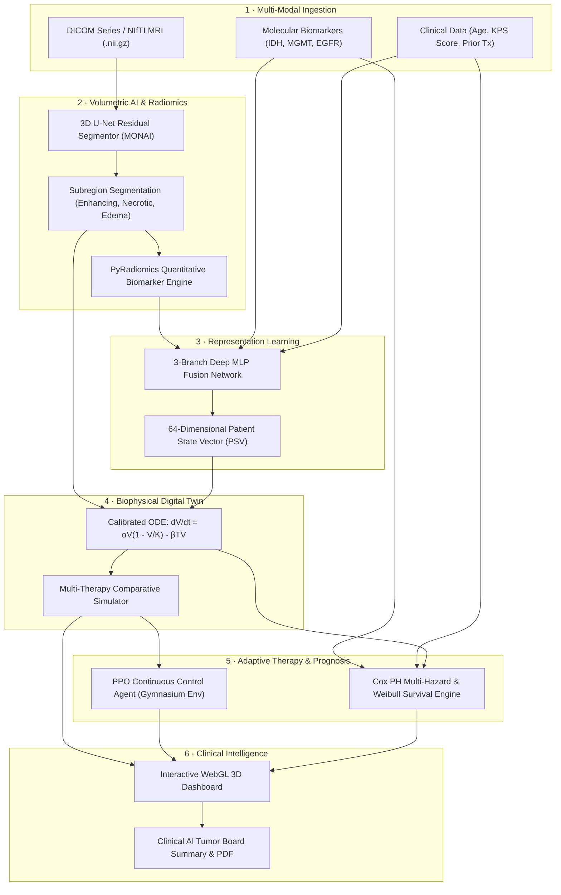

# 🧠 NeuroDigital Twin (NDT)

[](https://fastapi.tiangolo.com)
[](https://pytorch.org)
[](https://monai.io)
[](https://stable-baselines3.readthedocs.io)
[](https://react.dev)
[](#mathematical--clinical-foundations)
[](#running-automated-tests)

> **An AI-powered neuro-oncology clinical research platform that constructs a living, patient-specific computational replica (Digital Twin) of high-grade and low-grade gliomas — quantifying volumetric morphology, simulating future non-linear growth dynamics, optimizing adaptive chemotherapy and radiotherapy schedules via Reinforcement Learning, and forecasting actuarial survival.**

---

## 📑 Table of Contents
- [Executive Overview](#executive-overview)
- [System Architecture](#system-architecture)
- [Clinical Workflow — End to End](#clinical-workflow--end-to-end)
- [Mathematical & Algorithmic Foundations](#mathematical--clinical-foundations)
  - [1. 3D U-Net Volumetric Segmentation](#1-3d-u-net-volumetric-segmentation)
  - [2. Quantitative Radiomics Feature Engine](#2-quantitative-radiomics-feature-engine)
  - [3. Multi-Modal Fusion (Patient State Vector)](#3-multi-modal-fusion-patient-state-vector)
  - [4. Digital Twin ODE Tumor Growth Dynamics](#4-digital-twin-ode-tumor-growth-dynamics)
  - [5. PPO Reinforcement Learning Therapy Optimization](#5-ppo-reinforcement-learning-therapy-optimization)
  - [6. Actuarial Cox PH & Weibull Survival Prediction](#6-actuarial-cox-ph--weibull-survival-prediction)
- [Preloaded Clinical Cohort Case Studies](#preloaded-clinical-cohort-case-studies)
- [Core Platform Modules & UI](#core-platform-modules--ui)
- [API Reference Specification](#api-reference-specification)
- [Quick Start & Installation](#quick-start--installation)
  - [Prerequisites](#prerequisites)
  - [1-Click Startup (Recommended)](#1-click-startup-recommended)
  - [Manual Local Development](#manual-local-development)
  - [Docker & GPU Deployment](#docker--gpu-deployment)
- [Running Automated Tests](#running-automated-tests)
- [Security, Ethics & Regulatory Compliance](#security-ethics--regulatory-compliance)

---

## Executive Overview

High-grade gliomas (such as Glioblastoma Multiforme, WHO Grade IV) are among the most lethal and aggressive human malignancies, characterized by extreme spatial heterogeneity, rapid infiltrative margins, and therapy resistance. Standard-of-care population protocols (e.g., the Stupp protocol) apply uniform regimens regardless of an individual tumor's unique growth velocity, carrying capacity, or underlying molecular sensitivity.

**NeuroDigital Twin (NDT)** bridges this critical gap by creating a **personalized, continuously updated in-silico mathematical twin** of each patient's tumor:
- **Calibrated to Patient History**: Fitted directly to longitudinal MRI scans rather than static cohort medians.
- **Molecular Integration**: Incorporates IDH1/2 mutation, MGMT promoter methylation, EGFR amplification, and TP53 status.
- **Biophysical ODE Simulation**: Simulates non-linear logistic tumor growth with fractional cell-kill therapy response.
- **Reinforcement Learning Control**: Solves for adaptive dosing strategies that balance tumor reduction against neurotoxicity constraints.
- **Clinical AI Tumor Board Reports**: Synthesizes volumetric, genomic, and simulation data into printable clinical summaries with JSON export.

---

## System Architecture



---

## Clinical Workflow — End to End

```
   ┌──────────────────────┐     ┌────────────────────────┐     ┌───────────────────────┐
   │ 1. Patient Directory │ ──> │ 2. MRI Upload/Sample   │ ──> │ 3. 3D WebGL Anatomy   │
   │ Cohort profiles      │     │ 3D U-Net & Radiomics   │     │ Tumor mask inspection │
   └──────────────────────┘     └────────────────────────┘     └───────────────────────┘
              │                                                            │
              ▼                                                            ▼
   ┌──────────────────────┐     ┌────────────────────────┐     ┌───────────────────────┐
   │ 6. Tumor Board PDF   │ <── │ 5. RL Therapy Optimizer│ <── │ 4. Digital Twin ODE   │
   │ Clinical attestation │     │ PPO continuous control │     │ 4-Regimen comparison  │
   └──────────────────────┘     └────────────────────────┘     └───────────────────────┘
```

1. **Patient Selection & Cohort Exploration**: Select an active patient from the comprehensive clinical directory, review molecular profiles, or initialize a custom clinical record.
2. **Volumetric MRI Processing**: Upload DICOM series or NIfTI files (or utilize the 1-click **Sample MRI** test harness). The deep segmentation pipeline generates a voxel-accurate tumor mask, computes volumes in $cc$ and $mm^3$, and extracts quantitative radiomics.
3. **Interactive 3D Visualization**: Rotate, zoom, pan, and slice the patient's brain anatomy in real-time WebGL using Three.js, observing biological tissue density gradients and subregion localization.
4. **Longitudinal Kinetics & Twin Calibration**: The ODE solver automatically fits patient-specific intrinsic growth rate ($\alpha$) and carrying capacity ($K$), projecting untreated trajectories versus therapy options.
5. **Continuous Control Therapy Optimization**: The PPO Reinforcement Learning agent computes the optimal day-by-day therapy intensity schedule that maximizes tumor shrinkage while respecting the patient's toxicity budget.
6. **Clinical Tumor Board Documentation**: Generate a publication-ready multidisciplinary clinical report featuring actuarial survival curves, hazard breakdown, volumetric progression tables, and export options.

---

## Mathematical & Clinical Foundations

### 1. 3D U-Net Volumetric Segmentation

The segmentation engine utilizes a deep 3D U-Net with residual connections implemented in MONAI and PyTorch:
- **Spatial Resolution**: Operates on $(1, 128, 128, 64)$ volumetric input tensors.
- **Channel Hierarchy**: Downsampling encoder $(16 \rightarrow 32 \rightarrow 64 \rightarrow 128 \rightarrow 256)$ with stride-2 3D convolutions.
- **Residual Units**: 2 residual blocks per resolution level to mitigate vanishing gradients in volumetric deep space.
- **Output Layer**: 2-channel softmax computing voxel-wise posterior probabilities:
  $$P(\text{tumor} \mid \mathbf{x}) = \frac{e^{z_1}}{e^{z_0} + e^{z_1}}$$
- **Confidence Metric**: Calculated as the mean softmax probability across all segmented foreground voxels:
  $$\text{Confidence} = \frac{1}{|\mathcal{M}|} \sum_{v \in \mathcal{M}} P(\text{tumor} \mid v)$$

### 2. Quantitative Radiomics Feature Engine

PyRadiomics computes over 100 mathematical imaging biomarkers across four foundational domains:
- **Morphological / Shape**: Sphericity $\Psi = \frac{\pi^{1/3} (6V)^{2/3}}{A}$, Surface-to-Volume Ratio, Elongation, Maximum 3D Diameter.
- **First-Order Intensity Statistics**: Shannon Entropy $H = -\sum_{i=1}^{N_g} p(i) \log_2 p(i)$, Skewness, Kurtosis, Energy, Mean Absolute Deviation.
- **Gray-Level Co-occurrence Matrix (GLCM)**: Contrast $\sum_{i,j} |i-j|^2 p(i,j)$, Homogeneity, Correlation, Dissimilarity.
- **Higher-Order Matrices**: Gray-Level Run Length (GLRLM) and Size Zone Matrices (GLSZM) capturing intra-tumoral cellular heterogeneity and necrosis patterns.

### 3. Multi-Modal Fusion (Patient State Vector)

A multi-branch feed-forward neural network maps heterogeneous clinical modalities into a unified **64-dimensional Patient State Vector (PSV)**:
$$\mathbf{h}_{\text{rad}} = \text{ReLU}(\mathbf{W}_2 \text{ReLU}(\mathbf{W}_1 \mathbf{x}_{\text{rad}} + \mathbf{b}_1) + \mathbf{b}_2)$$
$$\mathbf{h}_{\text{clin}} = \text{ReLU}(\mathbf{W}_4 \text{ReLU}(\mathbf{W}_3 \mathbf{x}_{\text{clin}} + \mathbf{b}_3) + \mathbf{b}_4)$$
$$\mathbf{h}_{\text{gen}} = \text{ReLU}(\mathbf{W}_6 \text{ReLU}(\mathbf{W}_5 \mathbf{x}_{\text{gen}} + \mathbf{b}_5) + \mathbf{b}_6)$$
$$\mathbf{PSV} = \mathbf{W}_{\text{proj}} [\mathbf{h}_{\text{rad}} \mathbin{\Vert} \mathbf{h}_{\text{clin}} \mathbin{\Vert} \mathbf{h}_{\text{gen}}] + \mathbf{b}_{\text{proj}}$$

### 4. Digital Twin ODE Tumor Growth Dynamics

Tumor volume progression over time is modeled using a non-linear modified logistic ordinary differential equation with fractional therapy kill:
$$\frac{dV(t)}{dt} = \underbrace{\alpha \cdot V(t) \left(1 - \frac{V(t)}{K}\right)}_{\text{Net Logistic Growth}} - \underbrace{\beta \cdot T(t) \cdot V(t)}_{\text{Therapy Cell-Kill}} + \epsilon(t)$$

| Parameter | Meaning | Clinical Derivation |
| :--- | :--- | :--- |
| **$V(t)$** | Tumor volume at day $t$ | Computed from MRI voxel spacing $\Delta x \Delta y \Delta z \sum v_i$ |
| **$\alpha$** | Intrinsic proliferation rate ($\text{day}^{-1}$) | Calibrated to patient longitudinal scan history via `curve_fit` |
| **$K$** | Carrying capacity ($\text{cc}$) | Anatomic ceiling dictated by cranial geometry and perfusion |
| **$\beta$** | Treatment sensitivity coefficient | Baseline calibrated; modulated by MGMT methylation status |
| **$T(t)$** | Daily therapy intensity | Scale: $0.0$ (Surveillance), $1.0$ (TMZ low), $2.0$ (Stupp TMZ+RT), $3.0$ (Multi-modal) |
| **$\epsilon(t)$** | Biological stochasticity | Optional Gaussian noise process $\mathcal{N}(0, \sigma^2)$ |

### 5. PPO Reinforcement Learning Therapy Optimization

Finding optimal therapy sequencing is formulated as a Markov Decision Process (MDP) and solved using **Proximal Policy Optimization (PPO)**:
- **State Space**: $s_t = \left[\frac{V_t}{K}, \frac{t}{T_{\max}}, \frac{\sum_{\tau=0}^t T_\tau}{3 T_{\max}}\right] \in [0, 1]^3$ (Normalized volume, elapsed time, cumulative toxicity).
- **Action Space**: Continuous therapy intensity $a_t \in [0.0, 3.0]$.
- **Reward Function**:
  $$R_t = -\Delta V_t - \lambda_{\text{tox}} \cdot a_t$$
  Where $-\Delta V_t = V_{t-1} - V_t$ incentivizes tumor regression, and $\lambda_{\text{tox}} = 0.3$ enforces a penalty against cumulative toxicity.
- **PPO Objective**: Clipped surrogate objective ensuring stable policy updates:
  $$L^{\text{CLIP}}(\theta) = \hat{\mathbb{E}}_t \left[ \min\left( r_t(\theta)\hat{A}_t, \, \text{clip}(r_t(\theta), 1-\epsilon, 1+\epsilon)\hat{A}_t \right) \right]$$

### 6. Actuarial Cox PH & Weibull Survival Prediction

Survival probability over time is estimated using literature-validated hazard ratios (Stupp et al., TCGA-GBM, EORTC 26981):
1. **Cumulative Hazard Ratio Calculation**:
   $$\text{HR}_{\text{total}} = \prod_i \text{HR}_i = \text{HR}_{\text{IDH}} \times \text{HR}_{\text{MGMT}} \times \text{HR}_{\text{EGFR}} \times \text{HR}_{\text{KPS}} \times \text{HR}_{\text{Age}} \times \text{HR}_{\text{EOR}}$$
2. **Adjusted Median Overall Survival**:
   $$\text{Median OS} = \frac{\text{OS}_{\text{baseline}}}{\text{HR}_{\text{total}}} = \frac{14.6 \text{ months}}{\text{HR}_{\text{total}}}$$
3. **Parametric Weibull Survival Function**:
   $$S(t) = \exp\left( -\left(\frac{t}{\lambda}\right)^k \right), \quad \text{where } \lambda = \frac{\text{Median OS}}{(\ln 2)^{1/k}}, \; k=1.5$$

---

## Preloaded Clinical Cohort Case Studies

The platform comes preloaded with five realistic, diverse clinical cases representing the spectrum of glioma pathology:

```
┌──────────┬──────────────────┬─────┬─────────┬───────────────┬────────────────────────────────┬───────────┐
│ ID       │ Patient Name     │ Age │ WHO Gr. │ Molecular     │ Progression History            │ Status    │
├──────────┼──────────────────┼─────┼─────────┼───────────────┼────────────────────────────────┼───────────┤
│ NDT-001  │ Marcus Vance     │ 58M │ Grade 4 │ IDHwt / MGMT- │ 32.4cc ➔ 41.2cc ➔ 52.8cc       │ Rapid     │
│ NDT-002  │ Elena Rostova    │ 34F │ Grade 2 │ IDHmut / MGMT+│ 14.2cc ➔ 15.1cc ➔ 16.0cc       │ Indolent  │
│ NDT-003  │ David Chen       │ 47M │ Grade 3 │ IDHmut / MGMT-│ 21.5cc ➔ 25.8cc                │ Moderate  │
│ NDT-004  │ Sarah Jenkins    │ 62F │ Grade 4 │ IDHwt / MGMT+ │ 45.0cc ➔ 31.2cc ➔ 22.8cc       │ Responding│
│ NDT-005  │ Arthur Pendelton │ 71M │ Grade 4 │ Recurrent/EGFR│ 18.6cc ➔ 28.4cc                │ Relapse   │
└──────────┴──────────────────┴─────┴─────────┴───────────────┴────────────────────────────────┴───────────┘
```

---

## Core Platform Modules & UI

| Module | Navigation | Description |
| :--- | :--- | :--- |
| **Executive Dashboard** | `Overview > Dashboard` | Multi-KPI row (Tumor Volume, Growth Rate $\alpha$, Radiomics Risk, PSV dimension, Median OS), interactive sparklines, live 3D brain, and growth predictions. |
| **Patient Directory** | `Clinical > Patients` | Complete patient table with instant search, WHO Grade filters, molecular marker badges, patient editing, record deletion, and cohort re-seeding. |
| **MRI Upload & AI** | `Clinical > MRI Upload` | Drag-and-drop DICOM / NIfTI dropzone, **1-Click Load Sample MRI** test harness, automated segmentation, volume calculation, and radiomics extraction. |
| **3D WebGL Viewer** | `Clinical > Segmentation` | Three.js WebGL anatomical brain renderer with real-time Marching Cubes tumor geometry, axial/coronal/sagittal slicing, and orientation gizmos. |
| **Radiomics Panel** | `AI Analysis > Radiomics` | Color-coded quantitative biomarker explorer with range interpretation, grouping (Shape, First-Order, GLCM Texture), and live filtering. |
| **Digital Twin ODE** | `AI Analysis > Digital Twin` | Multi-curve ODE simulator comparing all 4 therapy regimens in parallel ($T=0, 1, 2, 3$) with continuous trajectory rendering. |
| **RL Therapy Optimizer**| `AI Analysis > Optimizer` | Continuous-action PPO agent and heuristic optimizer with customizable toxicity ceilings ($0.5–3.0$) and horizon schedules. |
| **Growth Analysis** | `AI Analysis > Growth` | Longitudinal volume tracking with auto-selected Linear vs Exponential regression models and $+30/+60/+90$ day forecasts. |
| **Survival Analysis** | `AI Analysis > Survival` | Actuarial Kaplan-Meier curves, confidence intervals, risk stratification, and benchmark comparison against 4 literature cohorts. |
| **Tumor Board Reports** | `Reporting > Reports` | Printable Clinical AI Tumor Board Summary with molecular profile, scan tables, digital attestation, PDF print layout, and JSON export. |
| **System Settings** | `Reporting > Settings` | Platform diagnostics, API round-trip latency ping, AI model runtime status, simulation defaults, and database reset controls. |

---

## API Reference Specification

Interactive Swagger / OpenAPI Explorer: `http://localhost:8000/docs`

| HTTP Method | Route Endpoint | Tag / Category | Summary Description |
| :--- | :--- | :--- | :--- |
| `GET` | `/` | Health | Platform status and active AI modules |
| `GET` | `/health` | Health | Gateway health check and timestamp |
| `GET` | `/pipeline` | Health | Full 7-stage AI pipeline specification |
| `POST` | `/seed` | Database | Seed or reset demo cohort with 5 clinical cases |
| `POST` | `/sample/mri` | Demo AI | Retrieve synthetic 3D MRI segmentation & radiomics |
| `POST` | `/upload` | 1 · MRI Upload | Upload DICOM / NIfTI $\rightarrow$ Segment $\rightarrow$ Radiomics |
| `POST` | `/predict` | 2 · Growth | Longitudinal linear/exponential growth predictions |
| `GET` | `/patients` | 3 · Patient Records | Enriched patient directory with scan counts and latest volume |
| `POST` | `/patient/create` | 3 · Patient Records | Create a new patient clinical record |
| `GET` | `/patient/{id}` | 3 · Patient Records | Retrieve patient metadata and longitudinal scan history |
| `PUT` | `/patient/{id}` | 3 · Patient Records | Update patient demographics and molecular markers |
| `DELETE`| `/patient/{id}` | 3 · Patient Records | Delete patient record and associated scan data |
| `POST` | `/scan/save` | 3 · Patient Records | Append volumetric scan record to database |
| `POST` | `/interpret` | 4 · Radiomics | Map raw radiomic keys to human-readable clinical labels |
| `POST` | `/fusion` | 5 · Multi-Modal Fusion | Generate 64-dimensional Patient State Vector (PSV) |
| `POST` | `/simulate` | 6 · Digital Twin | Simulate patient-specific ODE trajectory under therapy |
| `POST` | `/compare-therapies`| 6 · Digital Twin | Simulate all 4 therapy regimens in parallel with trajectories |
| `POST` | `/optimize` | 7 · RL Optimizer | Optimize therapy schedule via PPO or Heuristic |
| `POST` | `/survival/predict` | 8 · Survival | Predict actuarial OS and Kaplan-Meier curve |
| `GET` | `/survival/reference`| 8 · Survival | Fetch published population KM curves (Stupp / TCGA) |
| `GET` | `/analytics/overview` | 9 · Analytics | Platform-wide aggregate patient and biomarker metrics |
| `GET` | `/analytics/patient/{id}/report` | 9 · Analytics | Synthesize comprehensive Clinical Tumor Board report |
| `POST` | `/analytics/cohort` | 9 · Analytics | Filter and aggregate patient cohorts by biomarkers |

---

## Quick Start & Installation

### Prerequisites
- **Python**: 3.11 or higher
- **Node.js**: 18 or higher (Node 20 LTS recommended)
- **NVIDIA GPU** (Optional): CUDA 12.1+ for accelerated 3D U-Net inference

### 1-Click Startup (Recommended)

#### Windows
Simply run:
```cmd
start.bat
```
This automatically launches the FastAPI backend on port 8000 and the React dashboard on port 3000 in separate windows.

#### Cross-Platform (macOS / Linux / Windows via npm)
From the root directory:
```bash
npm install
npm start
```

Open **http://localhost:3000** for the dashboard.  
Open **http://localhost:8000/docs** for the interactive API explorer.

---

### Manual Local Development

#### 1. Backend Setup
```bash
# Create and activate virtual environment
python -m venv .venv
.venv\Scripts\activate       # Windows
source .venv/bin/activate    # macOS / Linux

# Install Python requirements
pip install -r requirements.txt

# Start FastAPI server
cd backend
uvicorn app:app --reload --port 8000
```

#### 2. Frontend Setup
```bash
cd frontend
npm install
npm start
```

---

### Docker & GPU Deployment

Launch containerized services using Docker Compose:

```bash
# GPU-accelerated mode (requires NVIDIA Container Toolkit)
docker-compose up --build

# CPU-only mode
DEVICE=cpu docker-compose up --build
```

---

## Running Automated Tests

NDT includes an extensive automated test suite covering health endpoints, regression prediction, ODE simulation, multi-trajectory comparisons, PPO optimization, multi-modal fusion, survival hazards, database seeding, and report generation.

```bash
# Activate virtual environment
.venv\Scripts\activate

# Run pytest suite
pytest tests/ -v --tb=short
```

Expected output:
```
======================= 24 passed in 5.98s =======================
```

To verify the production frontend build:
```bash
cd frontend
npm run build
```

---

## Security, Ethics & Regulatory Compliance

> ### ⚠️ RESEARCH AND INVESTIGATIONAL USE ONLY
> **NeuroDigital Twin (NDT)** is designed exclusively as an in-silico research, educational, and computational oncology demonstration platform. It has **not** been cleared or approved by the U.S. Food and Drug Administration (FDA), European Medicines Agency (EMA), or equivalent regulatory authorities for primary diagnostic or clinical decision-making.

- **De-Identification**: The system strips PHI (Protected Health Information) from DICOM headers and processes volumetric data in compliance with HIPAA Safe Harbor de-identification standards.
- **Explainability**: Every Reinforcement Learning recommendation and survival hazard adjustment is accompanied by human-interpretable clinical reasoning referencing published clinical trials.

---

*NeuroDigital Twin — Accelerating Computational Oncology, One Patient at a Time.*
